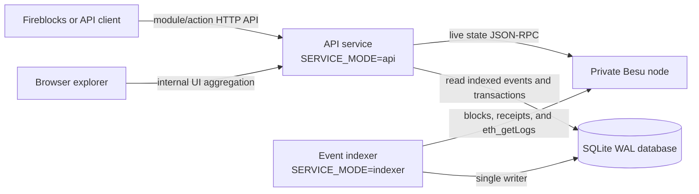
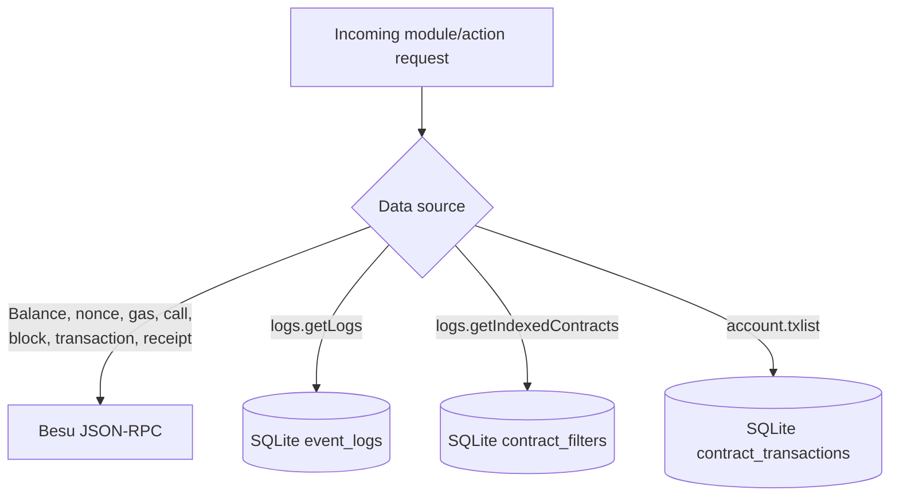

# Architecture overview

## Purpose

The Besu RPC Proxy is a lightweight Java service for a private Hyperledger
Besu network. It provides a bounded Blockscout/Etherscan-compatible API for
Fireblocks and a small browser-based explorer without requiring Blockscout,
PostgreSQL, or Redis.

The system has two data-access paths:

- Current chain state is read directly from Besu JSON-RPC.
- Allowlisted contract event logs and top-level contract transactions are
  indexed into SQLite and queried through `logs.getLogs` and `account.txlist`.

It does not attempt to provide a complete blockchain explorer index.

## System architecture

The API and indexer use the same application image. `SERVICE_MODE` selects
which role starts:

| Mode | Processes |
| --- | --- |
| `api` | HTTP API, explorer UI, Swagger, SQLite reader |
| `indexer` | Besu polling and SQLite writer; no HTTP server |
| `all` | API and indexer in one JVM, primarily for local development |

The recommended container deployment runs `api` and `indexer` as separate
containers using the same image and a shared local Docker volume. Separating
the roles prevents an indexer restart from interrupting API traffic and keeps
SQLite writes owned by one process.

SQLite must remain on storage local to one Docker host. A shared SQLite file
over NFS or between multiple hosts is not supported.

## Service responsibilities

### API service

The API service uses the JDK HTTP server and exposes:

- `GET` and form-encoded `POST /api?module=...&action=...`
- Direct Besu-backed account, block, transaction, fee, and simulation calls
- SQLite-backed `logs.getLogs`
- Local index discovery through `logs.getIndexedContracts`
- Explorer static assets
- Internal Explorer, Nodes, and read-only QBFT Validator aggregation routes
- Swagger/OpenAPI and a downloadable Postman collection
- Liveness and Besu readiness endpoints

The Besu endpoint is server configuration. A caller cannot supply or override
the upstream RPC URL.

### Internal UI data path

The static UI does not call arbitrary JSON-RPC. It calls four undocumented,
same-origin routes under `/internal/ui/*`. These routes are excluded from the
Fireblocks OpenAPI and Postman contracts:

| Route | Purpose | Besu methods |
| --- | --- | --- |
| `/internal/ui/config` | Server-defined node choices | none |
| `/internal/ui/explorer` | Recent block/transaction aggregation | `eth_chainId`, `eth_blockNumber`, `eth_getBlockByNumber`, displayed transactions' `eth_getTransactionReceipt` |
| `/internal/ui/nodes/status` | Node operations view | `eth_blockNumber`, optional `admin_nodeInfo`, `net_peerCount`, `txpool_besuTransactions`, `admin_peers` |
| `/internal/ui/validators` | QBFT read-only view | `qbft_getValidatorsByBlockNumber`, optional `qbft_getPendingVotes` |

Explorer responses are cached in JVM memory for five seconds to avoid duplicate
browser refresh calls. The cache is disposable and is not an index or a source
of truth. Nodes and Validators are fetched live.

`BESU_NODES_CONFIG` may point to a server-side JSON node registry. Only its
allowlisted node names can be selected by the browser. Public `/api` actions and
the indexer continue to use the canonical `BESU_RPC_URL`.

### Event indexer

The indexer:

1. Reads `eth_chainId` and the current `eth_blockNumber`.
2. Calculates a safe head using `INDEXER_CONFIRMATIONS`.
3. Resumes from the durable SQLite checkpoint.
4. Fetches block headers in bounded batches.
5. Calls `eth_getLogs` only for configured contract addresses and optional
   `topic0` values.
6. Extracts top-level transactions involving configured contracts and fetches
   receipts only for matched calls and contract-creation candidates.
7. Writes blocks, logs, contract transactions, and the next checkpoint in one
   SQLite transaction.
8. Compares stored and canonical block hashes and rolls back indexed data when
   it detects a reorganization within `INDEXER_REORG_LOOKBACK`.

On the first run, `INDEXER_START_BLOCK` defines the initial block. If it is not
set, indexing starts after the current safe head, so historical events are not
backfilled. Once a checkpoint exists, changing `INDEXER_START_BLOCK` does not
rewind it.

## API data sources

Only `logs.getLogs` and allowlisted `account.txlist` expose indexed blockchain
data. The discovery action
`logs.getIndexedContracts` is a local extension for showing which log indexes
are available; it is not an official Blockscout action.

All other blockchain endpoints read live state from Besu and do not depend on
the indexer.

## SQLite schema

SQLite runs in WAL mode with a five-second busy timeout. The indexer is the
single writer, while the API service performs read queries.

### `schema_migrations`

Tracks schema versions applied by the application.

| Column | Type | Purpose |
| --- | --- | --- |
| `version` | INTEGER, primary key | Migration version |
| `applied_at` | TEXT | Application timestamp |

### `indexer_checkpoints`

Stores one resume position per chain.

| Column | Type | Purpose |
| --- | --- | --- |
| `chain_id` | TEXT, primary key | Hex Ethereum chain ID |
| `next_block` | INTEGER | Next block to index |
| `last_block_hash` | TEXT, nullable | Hash used for reorg detection |
| `updated_at` | TEXT | Last checkpoint update |

### `indexed_blocks`

Stores the minimal block information required for event timestamps and reorg
handling. It is not a complete block index.

| Column | Type | Purpose |
| --- | --- | --- |
| `chain_id` | TEXT | Chain identifier |
| `block_number` | INTEGER | Block height |
| `block_hash` | TEXT | Canonical hash when indexed |
| `parent_hash` | TEXT | Parent block hash |
| `block_timestamp` | INTEGER | Unix timestamp |

Primary key: `(chain_id, block_number)`.

### `contract_filters`

Records the contract and event filters registered by the indexer. The explorer
uses this table to display supported indexes.

| Column | Type | Purpose |
| --- | --- | --- |
| `chain_id` | TEXT | Chain identifier |
| `address` | TEXT | Indexed contract address |
| `topic0` | TEXT | Event signature hash, or empty for all events |
| `start_block` | INTEGER | Earliest configured block for this filter |
| `created_at` | TEXT | Registration timestamp |

Primary key: `(chain_id, address, topic0)`.

### `event_logs`

Stores raw EVM logs. ABI decoding and derived token balances are deliberately
outside the current scope.

| Column | Type | Purpose |
| --- | --- | --- |
| `chain_id` | TEXT | Chain identifier |
| `block_number` | INTEGER | Emitting block |
| `block_hash` | TEXT | Emitting block hash |
| `transaction_hash` | TEXT | Emitting transaction |
| `transaction_index` | INTEGER | Transaction position in the block |
| `log_index` | INTEGER | Log position within the block |
| `address` | TEXT | Emitting contract |
| `topic0` … `topic3` | TEXT, nullable | Individually searchable topics |
| `topics_json` | TEXT | Complete ordered topic array |
| `data` | TEXT | Raw event data |
| `block_timestamp` | INTEGER | Unix timestamp copied from the block |

Primary key: `(chain_id, transaction_hash, log_index)`.

Secondary indexes support block-range, contract-address, and `topic0`
queries. `topic1` through `topic3` can be filtered but do not currently have
dedicated secondary indexes.

### `contract_transactions`

Stores top-level transactions related to configured contracts. Quantities stay
as hexadecimal text in storage to avoid overflowing SQLite integers; the API
converts them to Etherscan-compatible decimal strings.

| Column family | Purpose |
| --- | --- |
| `chain_id`, `indexed_contract_address`, `transaction_hash` | Composite identity and allowlist ownership |
| `block_number`, `block_hash`, `block_timestamp`, `transaction_index` | Ordering, paging, confirmations, and reorg rollback |
| `from_address`, `to_address`, `created_contract_address` | Transaction participants and deployment result |
| `nonce`, `value`, `gas`, fee fields, `input`, `transaction_type` | Original transaction data |
| `receipt_status`, `gas_used`, `effective_gas_price` | Mined execution result |

Primary key: `(chain_id, indexed_contract_address, transaction_hash)`. A
secondary index supports contract/block ordered queries.

When an existing schema-v2 event database first upgrades to schema v3, the
migration rewinds each chain checkpoint to its earliest registered
`contract_filters.start_block`. Blocks and logs are idempotently reprocessed so
the new transaction table is historically backfilled without deleting the
existing event index.

## Technology stack

| Layer | Technology |
| --- | --- |
| Language/runtime | Java 21 |
| Build | Gradle 8.10.2 Wrapper |
| HTTP server | JDK `com.sun.net.httpserver.HttpServer` |
| Besu client | JDK `java.net.http.HttpClient` |
| JSON | Small in-project parser/serializer |
| Database | SQLite in WAL mode |
| Database driver | Xerial SQLite JDBC 3.47.2.0 |
| Logging bridge | SLF4J NOP 2.0.16 for the JDBC driver |
| Frontend | Static HTML, CSS, and browser JavaScript |
| API specification | OpenAPI 3.0 JSON and local Swagger viewer |
| Packaging | Multi-stage Docker build using Eclipse Temurin 21 |
| Orchestration | Docker Compose |

There is no Spring, Hibernate, Flyway, PostgreSQL, Redis, Node.js runtime, or
Elixir runtime in this standalone service.

## Configuration

| Variable | Default | Description |
| --- | --- | --- |
| `SERVICE_MODE` | `api` | `api`, `indexer`, or `all` |
| `HTTP_HOST` | `127.0.0.1` | API bind address |
| `HTTP_PORT` | `8080` | API port |
| `BESU_RPC_URL` | `http://127.0.0.1:8545` | Fixed Besu JSON-RPC endpoint |
| `BESU_RPC_TIMEOUT_MS` | `5000` | Upstream call timeout |
| `BESU_NODES_CONFIG` | unset | Optional server-side JSON registry for internal UI node selection |
| `SQLITE_PATH` | `./data/indexer.sqlite` | SQLite database location |
| `INDEXER_CONTRACT_ADDRESSES` | none | Required comma-separated allowlist in indexer mode |
| `INDEXER_TOPIC0` | none | Optional comma-separated event signature hashes |
| `INDEXER_START_BLOCK` | current safe head + 1 | Initial decimal block number |
| `INDEXER_CONFIRMATIONS` | `0` | Blocks kept behind the chain head |
| `INDEXER_BATCH_SIZE` | `500` | Maximum blocks processed per poll |
| `INDEXER_POLL_INTERVAL_MS` | `2000` | Delay between polling attempts |
| `INDEXER_REORG_LOOKBACK` | `128` | Maximum automatic rollback search depth |

For Docker Compose, copy `.env.example` to `.env`. Compose automatically reads
that file and passes the explicitly mapped values in `docker-compose.yml` to
the containers. The JVM itself does not implement dotenv parsing, so direct
host execution must use exported or inline environment variables.

## Current boundaries

The service does not currently index or derive:

- Complete arbitrary account history and internal contract calls
- Internal transactions or EVM traces
- Decoded ERC-20, ERC-721, or ERC-1155 transfers
- Current or historical token balances and holder lists
- Contract source, ABI, or verification metadata
- Statistics, charts, or aggregate counters
- User accounts, watchlists, or notifications

The SQLite design targets one bounded private chain, one indexer writer, a
small number of API readers, and allowlisted contract events. PostgreSQL should
be reconsidered when the system requires multiple writers or hosts, large
historical indexes, complex aggregation, high query concurrency, or formal
database high availability.

Redis is not required for correctness. It should only be introduced for a
measured need such as shared caching across API replicas, rate limiting,
distributed coordination, or a job queue.

## Related documentation

- [README](../README.md)
- [API support matrix](api-support-matrix.md)
- Swagger UI: `/swagger` on a running service
- OpenAPI document: `/openapi.json` on a running service
