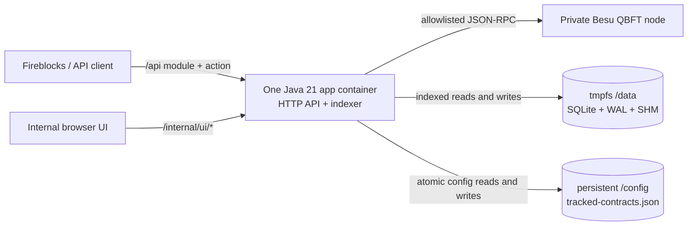
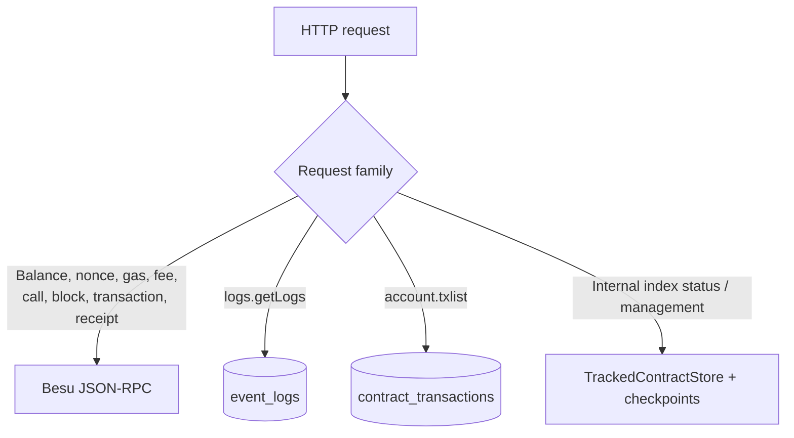

# Architecture overview

## Purpose

This is a bounded Java service for a private Besu QBFT network. It provides a
Blockscout/Etherscan-compatible API for Fireblocks and an internal explorer
without running Blockscout, PostgreSQL, or Redis.

- Live chain state is read directly from Besu JSON-RPC.
- Only configured contracts' events and top-level transactions are indexed.
- Docker stores the SQLite index in RAM and persists only the small contract
  configuration.

It is not intended to become a complete general-purpose chain explorer.

## Runtime architecture

Docker Compose intentionally runs `SERVICE_MODE=all` in one container. One JVM
owns both the API and the SQLite writer, which avoids cross-container access to
an ephemeral SQLite file and makes dynamic contract changes immediately visible
to the indexer.

The Java binary still supports `api`, `indexer`, and `all` modes for development
or future deployments, but the supported Compose topology is one `app`
container.

## Memory and persistence boundaries

| Path | Backing store | Lifetime | Contents |
| --- | --- | --- | --- |
| `/data/indexer.sqlite` | Docker tmpfs (RAM) | Container lifetime | SQLite main database |
| `/data/indexer.sqlite-wal` | Docker tmpfs (RAM) | Container lifetime | Uncheckpointed WAL pages |
| `/data/indexer.sqlite-shm` | Docker tmpfs (RAM) | Container lifetime | WAL coordination metadata |
| `/config/tracked-contracts.json` | Named Docker volume | Across restarts/recreates | Names, addresses, topics, enabled state, start blocks |

The default tmpfs limit is 256 MiB, the JVM heap is capped at 384 MiB, and the
container limit is 1 GiB. The remaining headroom covers native JVM memory,
thread stacks, the SQLite driver, HTTP buffers, and tmpfs pages. tmpfs usage is
charged to the container memory limit; its `size` is a ceiling, not preallocated
RAM.

Because SQLite is disposable, the application exposes indexer state and
per-contract progress. Explorer and Contracts pages warn users until the safe
head has been reached.

## Request data paths

Public API requests never supply an upstream RPC URL or arbitrary method name.
The dispatcher maps each supported module/action to a fixed Besu method or a
bounded SQLite query.

## Dynamic tracked-contract lifecycle

1. On first boot, `TrackedContractStore` creates `tracked-contracts.json` from
   `INDEXER_CONTRACT_ADDRESSES`, `INDEXER_TOPIC0`, and `INDEXER_START_BLOCK`.
2. Once the file exists it is the source of truth; later `.env` changes do not
   silently overwrite UI-managed configuration.
3. `POST /internal/ui/contracts` validates the address format, current chain
   head, and deployed bytecode via `eth_getCode`.
4. Each enabled contract gets its own checkpoint and backfill.
5. Pause/resume changes configuration without a restart. Reindex resets only
   the selected contract's rows and checkpoint. Removal may optionally purge
   its currently indexed rows.
6. JSON changes are written to a sibling temporary file and renamed into place.

The optional `CONTRACT_ADMIN_TOKEN` protects mutations using the
`X-Contract-Admin-Token` header. These routes are internal and are excluded
from the Fireblocks OpenAPI and Postman collection.

## Indexer flow

For every poll:

1. Read `eth_chainId` and `eth_blockNumber`; subtract confirmations to obtain a
   safe head.
2. Load the persistent tracked-contract list.
3. For each enabled contract, initialize or load its independent checkpoint.
4. Compare the last indexed block hash with Besu and roll back that contract on
   a reorganization within `INDEXER_REORG_LOOKBACK`.
5. Fetch a bounded block range with full top-level transactions.
6. Call `eth_getLogs` for that address and optional topic-0 allowlist.
7. Match direct `from`/`to` transactions and deployment receipts for that
   contract.
8. Commit blocks, logs, contract transactions, and the next checkpoint in one
   SQLite transaction.

Contracts are isolated at the checkpoint/error level: one invalid or failing
contract does not prevent the others from progressing. The current simple
implementation fetches block ranges per contract, prioritizing correctness and
isolation over maximum RPC efficiency. This can be optimized into shared block
fetches if the allowlist becomes large.

## SQLite schema

SQLite uses WAL mode and a five-second busy timeout.

### `schema_migrations`

Applied application schema versions.

### `contract_checkpoints`

One resume position per `(chain_id, contract_address)`:

| Column | Purpose |
| --- | --- |
| `start_block`, `next_block` | Independent backfill range/progress |
| `last_block_hash` | Reorg detection |
| `state` | `syncing`, `caught_up`, `paused`, or `error` |
| `last_error`, `updated_at` | Operational status |

### `indexed_blocks`

Minimal block number/hash/parent/timestamp data used for timestamps and reorg
handling. It is not a full block explorer table.

### `contract_filters`

The active chain/address/topic-0 query boundary. It also gates public
`logs.getLogs` and contract-only `account.txlist` access.

### `event_logs`

Raw EVM logs with block and transaction position, address, `topic0` through
`topic3`, complete topics JSON, data, and block timestamp. Secondary indexes
cover address/block and topic-0 queries.

### `contract_transactions`

Top-level transactions related to a configured contract, including deployment
results and receipt status/gas. Large Ethereum quantities remain hexadecimal
text in SQLite; the Etherscan response and browser presentation convert them
without using SQLite integer arithmetic.

### Legacy `indexer_checkpoints`

The old chain-wide checkpoint table remains only for migration compatibility.
New indexing uses `contract_checkpoints`.

## Internal UI routes

| Route | Purpose |
| --- | --- |
| `GET /internal/ui/config` | Server-defined node choices |
| `GET /internal/ui/explorer` | Recent blocks and transactions |
| `GET /internal/ui/nodes/status` | ADMIN/NET/TXPOOL operational view |
| `GET /internal/ui/validators` | Read-only QBFT view |
| `GET /internal/ui/transaction` | Transaction + receipt + block aggregation |
| `GET /internal/ui/indexer/status` | Overall/per-contract progress and tmpfs usage |
| `GET /internal/ui/contracts` | Tracked contract list and live index status |
| `POST /internal/ui/contracts` | Add a validated contract |
| `PATCH /internal/ui/contracts/{address}` | Pause or resume |
| `POST /internal/ui/contracts/{address}/reindex` | Reset one contract from a start block |
| `DELETE /internal/ui/contracts/{address}` | Stop tracking, optionally purge current rows |

Explorer aggregation is cached in JVM memory for five seconds. This cache is
disposable and is neither an index nor a source of truth.

## Technology stack

| Layer | Technology |
| --- | --- |
| Runtime | Java 21 |
| Build | Gradle 8.10.2 Wrapper |
| HTTP | JDK `HttpServer` and `HttpClient` |
| JSON | In-project parser/serializer |
| Database | SQLite WAL via Xerial SQLite JDBC |
| Frontend | Static HTML, CSS, browser JavaScript; no framework |
| API contract | OpenAPI 3.0 JSON, local Swagger viewer, Postman collection |
| Packaging | Eclipse Temurin multi-stage Docker image |
| Runtime user | Linux UID/GID 10001, non-root |

There is no Spring, Hibernate, Flyway, PostgreSQL, Redis, Node.js runtime, or
Elixir runtime.

## Scaling boundary

This design fits a bounded private chain, one app instance, a small contract
allowlist, and rebuildable historical data. Reconsider PostgreSQL when the
index must survive service loss, exceed the memory budget, support multiple
writers/hosts, serve high query concurrency, or add broad account/token
history and aggregates.

Redis is not required for correctness. Add it only for a measured need such as
shared caching across replicas, distributed rate limiting, coordination, or a
job queue.

## Related documentation

- [README](../README.md)
- [API support matrix](api-support-matrix.md)
